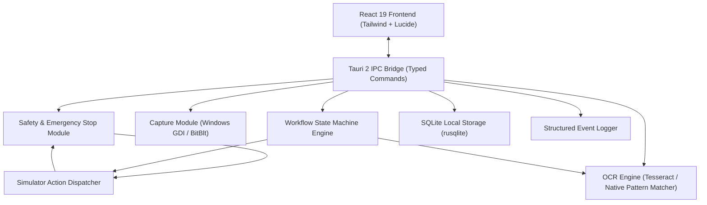

# Desktop Vision Automation Lab - System Architecture

## 1. Architectural Overview

The application is structured into a strictly sandboxed architecture:

1. **Frontend (React 19, TypeScript, Tailwind CSS)**:
   - Modern, responsive desktop user interface.
   - Provides views for Dashboard, Screen Reader, Text Recognition, Workflow Editor, Test Simulator, Activity Logs, and Settings.
   - Connects to the core engine via typed Tauri IPC invocations with fallback simulation for browser-based inspection.

2. **Core Engine (Rust)**:
   - **`safety`**: Manages the global atomic emergency stop flag and verifies that every target window is valid, minimized status, foreground status, and matches approved simulator window titles.
   - **`capture`**: Enumerates desktop windows safely using Win32 GDI and captures pixel buffers into PNG base64 strings.
   - **`ocr`**: Coordinates text extraction with confidence scores and bounding boxes via Tesseract CLI or integrated high-fidelity lab pattern recognition.
   - **`workflow`**: Implements a strict Finite State Machine (FSM) enforcing transition rules, timeout constraints, retry limits, and dry-run execution.
   - **`simulator`**: Executes mouse and action events restricted strictly to the designated simulator window using Windows Message queues.
   - **`storage`**: Embedded SQLite database (`automation_lab.db`) using `rusqlite` bundled for persistent settings, workflows, steps, and activity audit logs.
   - **`logging`**: Real-time structured telemetry capturing state changes, OCR outputs, and simulator actions.
