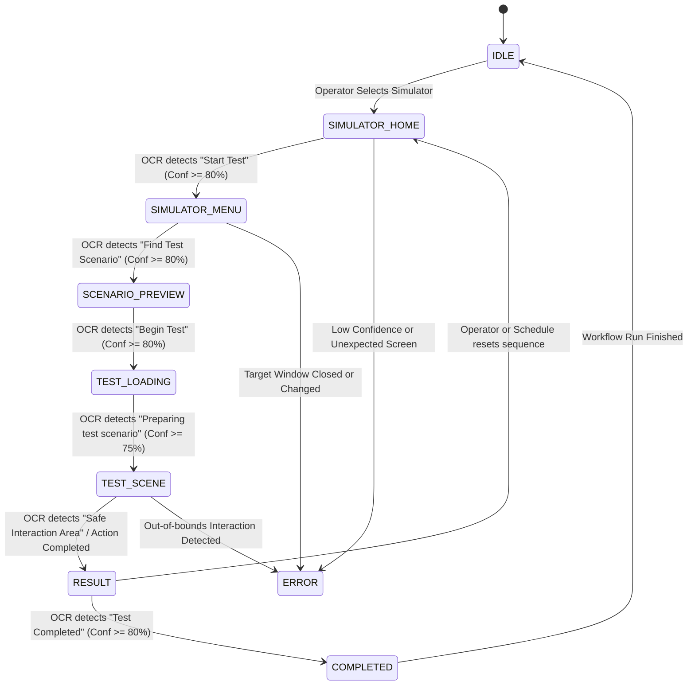

# Simulator Workflow State Machine

## Finite State Machine Sequence

## State Definitions & Required Evidence

| State | Expected Phrase | Min Confidence | Timeout (ms) | Retry Limit | Action Permitted |
| :--- | :--- | :--- | :--- | :--- | :--- |
| `IDLE` | N/A | 0% | 0 | 0 | None |
| `SIMULATOR_HOME` | `Start Test` | 80% | 10,000 | 3 | `CLICK_START_TEST` |
| `SIMULATOR_MENU` | `Find Test Scenario` | 80% | 10,000 | 3 | `CLICK_FIND_SCENARIO` |
| `SCENARIO_PREVIEW` | `Begin Test` | 80% | 10,000 | 3 | `CLICK_BEGIN_TEST` |
| `TEST_LOADING` | `Preparing test scenario` | 75% | 15,000 | 5 | None (Observe Only) |
| `TEST_SCENE` | `Safe Interaction Area` | 80% | 15,000 | 3 | `CLICK_SCENE_TARGET` |
| `RESULT` | `Test Completed`, `Return Home`| 80% | 10,000 | 3 | `CLICK_RETURN_HOME` |
| `COMPLETED` | N/A | 80% | 0 | 0 | None |
